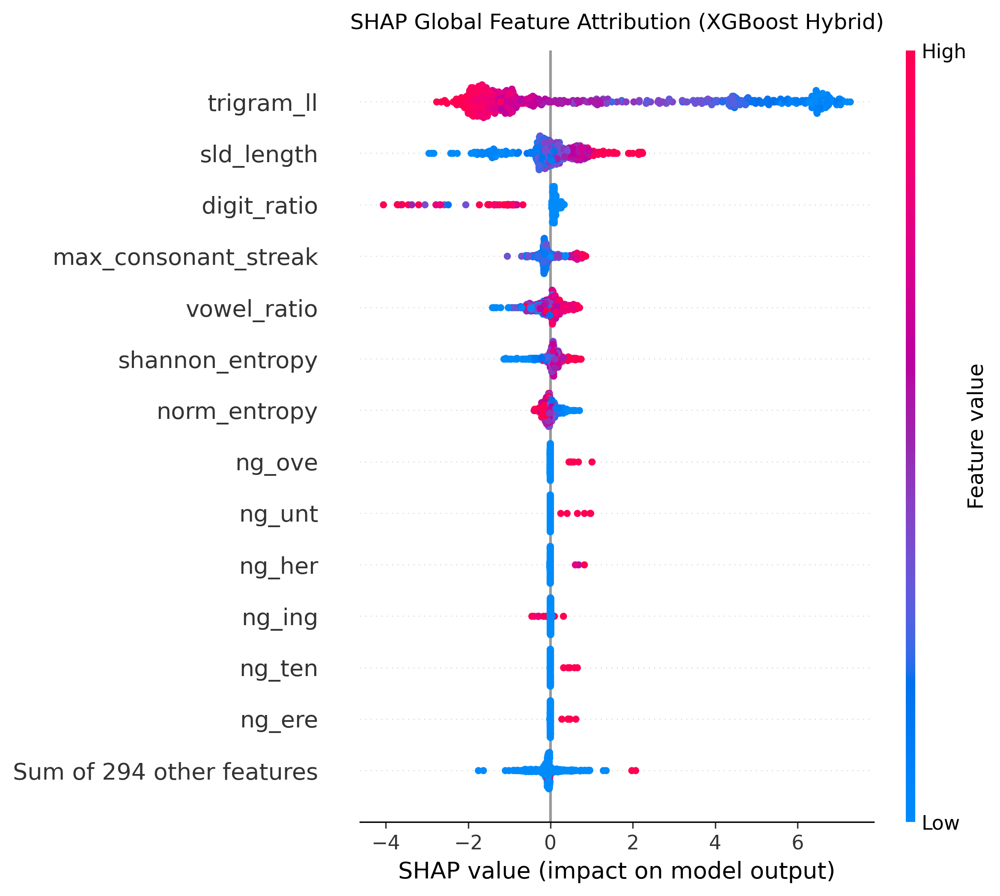
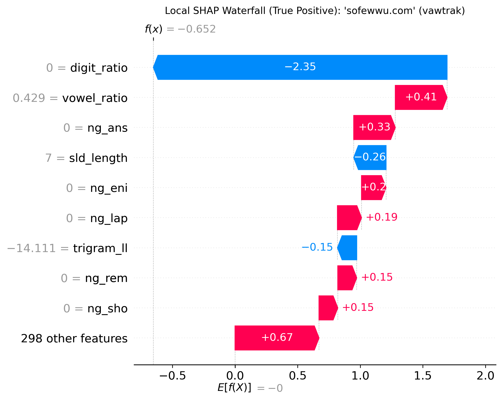

# Explainable AI for Lexical DGA Domain Detection

This project explores how character-level lexical features and n-gram patterns can be used to distinguish legitimate domains from domains generated by malware Domain Generation Algorithms (DGAs). Beyond classification accuracy, the main focus is on **explainability techniques**—using `TreeSHAP` and `LIME` to understand how tree ensembles make decisions on DNS strings and where character-level models break down.

Built in Python (Google Colab Notebook) as an exploratory study at the intersection of machine learning, network security, and explainable AI (XAI).

---

## What This Project Covers

The main goal is to evaluate whether a lightweight, CPU-friendly feature set can classify DGA domains using only the Second-Level Domain (SLD) string, and to audit the reliability of the resulting explanations between different approaches:

* **Lexical Feature Engineering:** SLD length, raw Shannon entropy, length-normalized entropy, vowel ratio, digit ratio, and maximum consecutive consonant streak.
* **Character pattern analysis & N-Gram Modeling:** A Markov character-trigram log-likelihood score (`trigram_ll`) fitted strictly on benign training domains, paired with sublinear TF-IDF character 3–4 grams (`max_features=300`).
* **Model Comparison:** Logistic Regression, Random Forest, and XGBoost (gradient boosting) across lexical (7 features) and hybrid (307 features) configurations.
* **Model evaluation:** Accuracy, precision, recall, F1-score, ROC-AUC, false-positive rate, and an inference-latency estimate.
* **Explainability & Stress Testing:** Global and local `TreeSHAP` visualizations, a run-to-run determinism and latency comparison between `TreeSHAP` and `LIME`, and diagnostic tests on tricky edge-case domains.

---

## Dataset

The experiment uses a stratified 20,000-domain sample (10,000 benign Alexa domains and 10,000 DGA domains across 25 malware families) sourced from [Christian Morbidoni's DGA_domains_dataset](https://github.com/chrmor/DGA_domains_dataset) (companion dataset to Cucchiarelli et al., *Expert Systems with Applications*, 2021).

To prevent Top-Level Domain suffixes (such as `.com` or `.org`) from manipulating character entropy and vowel ratios, domains are stripped to their Second-Level Domain (SLD) prior to feature extraction. A 5,000-row sample is included in `data/sample_domains.csv` for quick inspection.

---

## Experimental Results

### 1. Classifier & Feature Ablation Benchmark
Evaluated based on a held-out 20% stratified test split (4,000 domains; 16,000 training domains):

| Configuration | Accuracy | Precision | Recall | F1-Score | ROC-AUC | FPR | Inference Latency (ms / 1k) |
| :--- | :---: | :---: | :---: | :---: | :---: | :---: | :---: |
| **Logistic Regression (lexical)** | 0.8452 | 0.8557 | 0.8305 | 0.8429 | 0.9133 | 0.1400 | 0.172 |
| **Random Forest (lexical)** | 0.8568 | 0.8635 | 0.8475 | 0.8554 | 0.9264 | 0.1340 | 58.254 |
| **XGBoost (lexical)** | 0.8632 | 0.8900 | 0.8290 | 0.8584 | 0.9356 | 0.1025 | 8.580 |
| **Random Forest (Hybrid: Dense + TF-IDF)** | **0.8775** | **0.9085** | 0.8395 | **0.8727** | 0.9364 | **0.0845** | 54.291 |
| **XGBoost (Hybrid: Dense + TF-IDF)** | 0.8760 | 0.9017 | **0.8440** | 0.8719 | **0.9423** | 0.0920 | **9.878** |

**Confusion Matrix — XGBoost Hybrid (Test Set, $N = 4,000$):**
* **True Negatives (Benign Allowed):** 1,816 | **False Positives:** 184
* **True Positives (DGA Blocked):** 1,688 | **False Negatives:** 312

---

### 2. Explainability Analysis (`TreeSHAP` vs. `LIME`)

Global feature attribution across 500 test instances confirms that `trigram_ll` (benign trigram log-likelihood), `sld_length`, `digit_ratio`, and `max_consonant_streak` are the primary drivers of model decisions:



Local attribution for a verified True Positive DGA domain (`sofewwu.com`, `vawtrak` family, $f(x) = +1.57$):



**Explanation Repeatability & Latency (5 repeated runs on `sofewwu.com`):**
* **`TreeSHAP`:** `18.302 ms/query` — **1 unique top-3 feature ranking** across 5 runs (deterministic exact tree traversal).
* **`LIME`:** `176.547 ms/query` — **3 different top-3 feature rankings** across 5 runs (variance from stochastic perturbation sampling).

---

### 3. Edge-Case diagnostic results

Testing specific tricky domain patterns highlights both the strengths and the structural blind spots of character-level lexical detection:

| Domain | Pattern Category | Raw Entropy | Norm. Entropy | Trigram LL | DGA Prob | Verdict |
| :--- | :--- | :---: | :---: | :---: | :---: | :---: |
| `google.com` | Standard Benign | 1.92 | 0.74 | -12.34 | 0.0382 | `ALLOW (0)` |
| `car.com` | Short Benign (Max Norm. Entropy) | 1.58 | 1.00 | -10.07 | 0.0057 | `ALLOW (0)` |
| `gym.com` | Short Benign (No Standard Vowels) | 1.58 | 1.00 | -14.92 | 0.0137 | `ALLOW (0)` |
| `xkqz994j18a.info` | Alphanumeric PRNG DGA | 3.28 | 0.95 | -16.56 | 0.9879 | `BLOCK (1)` |
| `qzdfhgjklmnp.ru` | Consonant-Cluster DGA | 3.58 | 1.00 | -16.31 | 0.9988 | `BLOCK (1)` |
| `greenapplechair.com` | Wordlist Concatenation DGA | 3.19 | 0.82 | -11.32 | 0.2967 | `ALLOW (0)` |

While short benign domains (`car.com`, `gym.com`) are protected from false positives by their length and trigram scores, concatenated dictionary DGAs (`greenapplechair.com`, and families like `matsnu`) preserve natural English vowel ratios and character transitions, allowing them to evade purely character-level classifiers.


## How to Run

The easiest way to run the project is through Google Colab.

1. Open dga_lexical_xai_pipeline.ipynb in the repository.
2. Open the notebook in Google Colab or upload it to a Colab session.
3. Run the cells in order, starting with environment setup.

For a local Python environment, install the listed dependencies with:

```bash
pip install -r requirements.txt
```

The notebook downloads the dataset at runtime, trains multiple models, and generates visualizations. Execution time will depend on the runtime environment and package versions.

## Interpretation and Responsible use 

These outputs are intended to support an initial analysis of model behavior.
The predictions produced by this notebook should not be treated as definitive evidence that a domain is malicious or benign. The project has not been validated as a production DNS security system, and false positives and false negatives remain important considerations.

## License
This project is licensed under the MIT License — see the `LICENSE` file for details.
